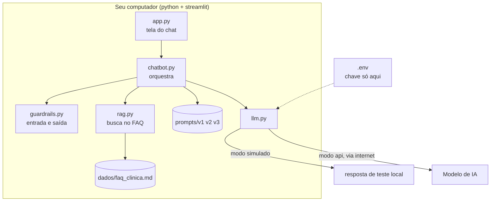

# 02. Arquitetura e decisões

## Visão geral
Tudo roda **no computador de quem testa**. Só a pergunta e os trechos do FAQ saem da máquina, e apenas no modo `api`, rumo ao modelo.

## O que cada arquivo faz
| Arquivo | Responsabilidade |
|---|---|
| `app.py` | Desenha a tela e repassa a pergunta |
| `chatbot.py` | Ordem do fluxo: protege a entrada, busca, monta a mensagem, chama o modelo, interpreta e protege a saída |
| `rag.py` | Lê o FAQ e acha os trechos mais parecidos com a pergunta |
| `llm.py` | Único ponto de contato com o modelo. Trocar de provedor = mudar só aqui |
| `guardrails.py` | Regras de proteção antes e depois do modelo |
| `avaliar.py` | Roda os casos de teste e mostra o placar por versão |

## Decisões e justificativas

### Por que Python puro e não n8n?
A maior parte da nota está em **prompts, personalização e avaliação**. Isso é muito mais fácil de **versionar, repetir e testar em código** (arquivos `v1.txt`, `v2.txt`, `v3.txt` e um script que roda os mesmos casos). O n8n continua útil como **próximo passo**: depois, ele pode chamar este mesmo serviço e ligar o chatbot ao WhatsApp.

### Por que RAG (R3) e não fine-tuning ou multimodal?
- O conhecimento da clínica está em **documentos que mudam** (horários, preços, convênios). Com RAG basta editar o FAQ.
- Fine-tuning exigiria exemplos rotulados, GPU, custo e cuidado com *overfitting*, sem ganho para este problema.
- Multimodal não é necessário: a entrada e a saída são texto.
- RAG também **permite citar a fonte**, o que reduz alucinação.

### Por que a busca é "por palavras" e não por embeddings?
Para a primeira versão, a busca por palavras (`rag.py`) **não exige nenhuma instalação** e é fácil de entender e depurar. Limitação conhecida: ela só acha palavras iguais, por isso o FAQ tem uma linha `Palavras-chave:` com sinônimos (foi um teste automático que mostrou que "horas" não era ligado a "horário").
**Evolução natural:** trocar `buscar()` por uma busca com embeddings (por exemplo, ChromaDB). O resto do projeto não muda.

### Por que Streamlit?
Um chat funcional em poucas linhas, sem HTML nem CSS, e que roda no navegador local.

### Por que rodar local (sem servidor)?
O objetivo é que **qualquer pessoa consiga executar seguindo o README**. Hospedar na internet traria custo, senha, risco de abuso da API e nenhum ganho de nota.

### Por que o modo simulado?
Para que o projeto rode **sem chave e sem custo** e para que os testes automáticos nunca chamem a API. Limitação: não mede a qualidade dos prompts.

## Limitações conhecidas
- A busca por palavras é simples e pode trazer trechos de assunto parecido, mas errado (por exemplo, "consulta" aparece em vários trechos).
- Os guardrails por regras (`guardrails.py`) pegam padrões conhecidos. Ataques novos podem passar: por isso existem os testes de ataque e o prompt v3.
- `llm.py` foi escrito para uma API específica e ainda não foi validado com chamada real.
- O FAQ é pequeno e fictício.

## Próximos passos (fora do escopo do trabalho)
Trocar a busca por embeddings, ligar ao WhatsApp via n8n, guardar histórico de conversa com cuidado de LGPD e medir custo por conversa.
