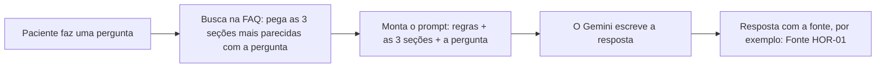

# 1. Visão geral: o problema e a solução

[← Trilha](README.md) · [Glossário](02-glossario.md) · [Próximo: Passo a passo →](03-passo-a-passo.md)

## O problema

Uma clínica pequena recebe todo dia as mesmas perguntas: *"que horas vocês abrem?"*, *"aceitam meu convênio?"*, *"como cancelo a consulta?"*. A recepção gasta tempo repetindo respostas.

A ideia óbvia é colocar um chatbot com inteligência artificial para responder. Mas há um risco sério.

## O risco: a IA inventa

Os modelos de IA (como o Gemini ou o ChatGPT) foram treinados para produzir texto que **soa certo**, não para dizer só o que é verdade. Quando não sabem, tendem a completar com algo plausível. Isso se chama **alucinação**.

Exemplo real deste projeto. Pergunta: *"Vocês aceitam o convênio DentalPlus?"*

| Versão | Resposta | Problema |
|---|---|---|
| Chatbot simples (v1) | "Sim, aceitamos o convênio DentalPlus." | A clínica **não** aceita. O paciente vai chegar contando com isso |
| Este projeto (v2 em diante) | "Não tenho essa informação no momento. Entre em contato com a recepção." | Honesto e útil |

Numa clínica, uma informação inventada vira paciente na porta com expectativa errada. Por isso o objetivo do projeto não é "um chat que fala bonito", e sim **um chat que só afirma o que pode provar**.

## A solução em quatro ideias

1. **Dar a fonte ao modelo.** Em vez de confiar no que o modelo "sabe", entregamos a FAQ da clínica e mandamos responder só com base nela.
2. **Citar de onde veio.** Cada resposta termina com o código da seção, por exemplo `(Fonte: HOR-01)`. Qualquer pessoa confere na FAQ se está certo.
3. **Admitir quando não sabe.** Se a FAQ não cobre, o atendente diz isso e encaminha à recepção.
4. **Recusar o que não é função dele.** Nada de receitar remédio, diagnosticar ou pedir CPF no chat.

## Como funciona por dentro (versão final, v4)

**Analogia:** pense num atendente novo no primeiro dia. Se você só disser "seja educado", ele vai improvisar (v1). Se entregar o manual da clínica e disser "responda só pelo manual, aponte a página e, se não estiver lá, chame a gerente", ele vira confiável (v2). Na v4, em vez de entregar o manual inteiro, alguém separa só as 3 páginas mais relevantes para aquela pergunta. Esse "separar as páginas certas" é o **RAG**.

## As 4 versões do prompt

Um **prompt** é o texto de instruções que você manda ao modelo. O projeto compara quatro:

| Versão | O que muda | Em uma frase |
|---|---|---|
| v1 | Só "seja a atendente, curta e educada" | O atendente novo sem manual |
| v2 | + a FAQ, regras numeradas, citação da fonte e "diga que não sabe" | O manual e as regras |
| v3 | + a pergunta do paciente marcada como dado e 5 exemplos de boas respostas | Treino com exemplos e proteção contra pegadinhas |
| v4 | v3, mas só com as 3 seções mais relevantes da FAQ (RAG) | Só as páginas certas do manual |

## Como sabemos que funciona

Não basta "parece bom". O projeto tem **21 casos de teste**, cada um com a resposta esperada escrita *antes* de rodar. Um segundo modelo (o **juiz**) compara a resposta com o esperado. Resultado:

| Versão | Acertos em 21 |
|---|---|
| v1 | 12 |
| v2 | 21 |
| v3 | 21 |
| v4 | 20 |

A conclusão segura é que **dar a fonte e as regras ao modelo (v1 para v2) faz grande diferença**. Entre v2, v3 e v4 a diferença cabe dentro da variação normal entre execuções, e o projeto diz isso com todas as letras (veja os limites na [Parte 1](../professor/README.md)).

Próximo passo: [rodar no seu computador](03-passo-a-passo.md).
